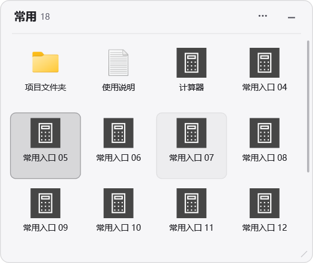
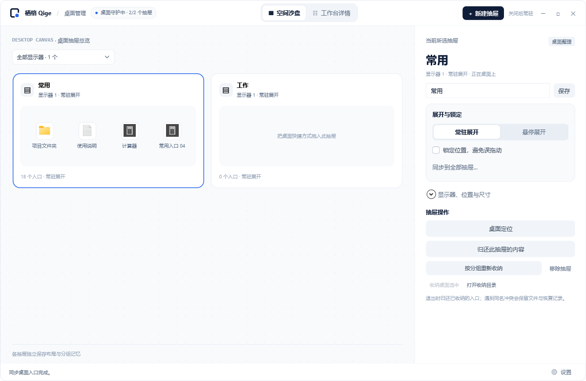
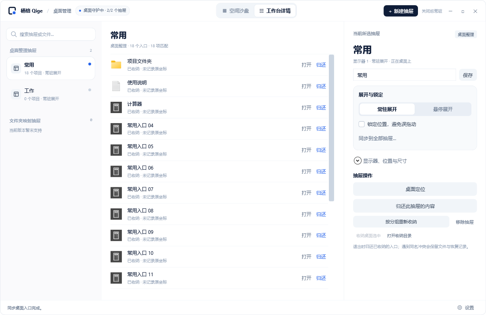

<p align="center">
  <picture>
    <source media="(prefers-color-scheme: dark)" srcset="assets/brand/qige-app-dark.svg">
    
  </picture>
</p>

<h1 align="center">栖格 Qige</h1>

<p align="center">
  <strong>给桌面留点空。</strong><br>
  用桌面抽屉整理快捷方式，让常用入口各归其位。
</p>

<p align="center">
  <a href="https://github.com/LaoQiTX/Qige/releases/tag/v0.1.0-beta.10">下载 beta.10</a> ·
  <a href="docs/user-guide.md">使用指南</a> ·
  <a href="docs/README.md">项目文档</a> ·
  <a href="docs/roadmap.md">开发计划</a> ·
  <a href="https://github.com/LaoQiTX/Qige/issues">反馈问题</a>
</p>

<p align="center">Windows 11 x64 · 安装包 / 便携版 · 中文界面</p>

## 看看栖格

测试版 **0.1.0-beta.10** 改善登录启动：后台直接恢复抽屉，修复管理面板黑屏及需要再次点击托盘的问题；优先使用当前用户登录任务。真实开机耗时待下次登录验收，详见[本次更新](docs/release-notes.md)。

把快捷方式拖进抽屉，按工作、娱乐或自己的习惯分组。抽屉可以自由摆放、调整大小、吸附对齐，也能折叠成标题条，在鼠标移入时展开。

**桌面抽屉**

<p align="center">
  
</p>

**管理面板 · 空间沙盘**



<details>
<summary>查看工作台详情与运行恢复面板</summary>

<br>

**工作台详情** — 搜索入口、查看抽屉内容，调整名称、布局与展开方式。



**运行与恢复** — 查看连接与性能信息，定位冲突文件并重试归还。


</details>

以上为当前版本的隔离样例截图。文件夹和文档图标是指向样例目标的快捷方式；普通文件与文件夹收纳尚未开放。

## 能做什么

- **多个桌面抽屉**：分别命名、移动、调整尺寸、滚动查看，并记住各自的布局。
- **随手整理**：拖入个人桌面快捷方式；单击选中、双击打开，拖回桌面解除分组。
- **悬停展开**：折叠时保留标题条，移入展开、离开收起；拖入时也能展开。
- **吸附与对齐**：对齐屏幕及相邻抽屉的边缘、中心线，按住 Alt 临时自由移动。
- **快捷方式同步**：识别软件更新后重建的同一入口，保留历史副本；无法可靠识别时提示处理。
- **托盘常驻**：关闭管理面板后继续运行，可选择登录 Windows 后启动。
- **集中恢复**：查看冲突位置、重试或另存副本；退出时等待文件操作并归还内容。
- **后台处理**：文件操作和图标解析在后台执行，提供本机性能记录。
- **统一设置**：底栏、托盘或 Ctrl+, 打开同一设置；展开方式与锁定可选择同步到全部抽屉。
- **图标右键**：打开、快捷方式所在位置、系统属性和单项归还，菜单与管理面板采用一致样式。

当前为测试版，支持**个人桌面根目录的 `.lnk` / `.url`**。文件夹映射、普通文件收纳和全桌面双击隐藏仍在[开发计划](docs/roadmap.md)中。

## 下载与开始使用

从 **[GitHub Releases](https://github.com/LaoQiTX/Qige/releases/tag/v0.1.0-beta.10)** 下载 Windows x64 版本：

| 版本 | 使用方式 |
| --- | --- |
| 安装包 `Qige-…-setup-win-x64.exe` | 通过中文向导选择可写目录，从开始菜单启动 |
| 便携包 `Qige-…-win-x64.zip` | 完整解压到固定、可写目录，运行 `Qige.exe` |

两种版本均自带 .NET 运行时。首次可运行“打开样例.cmd”体验界面，再开始整理自己的桌面。

1. 在管理面板中新建并命名抽屉。
2. 将个人桌面的快捷方式拖入抽屉。
3. 拖动标题或边缘调整布局，按需开启悬停展开。
4. 关闭面板后由托盘继续运行；完全退出时选择“退出并归还全部”。

**文件会实际收纳到软件目录内的 `QigeData`，正常退出后归还桌面。** 更新前先退出并归还，保留整个数据目录。更多说明见[使用指南](docs/user-guide.md)和[问题排查](docs/troubleshooting.md)。

## 文档

| 我想了解… | 文档 |
| --- | --- |
| 安装、整理桌面、管理抽屉 | [使用指南](docs/user-guide.md) |
| 冲突、找不到抽屉、恢复文件 | [问题排查](docs/troubleshooting.md) |
| 功能边界与两类抽屉的规划 | [产品规格](docs/product-spec.md) |
| 后续开发顺序 | [开发计划](docs/roadmap.md) |
| 技术原理、构建与发布 | [架构](docs/architecture.md) · [开发](docs/development.md) · [分发](docs/distribution.md) |
| 界面、图标与验证情况 | [设计](docs/design.md) · [验证](docs/validation.md) |

## 从源码运行

采用 C# / .NET 10、WPF、Win32 和 Windows Shell。需要 Windows 11 x64、PowerShell 7 和 .NET 10 SDK。

```powershell
.\build.ps1 -Configuration Release
.\build.ps1 -Task Demo -Configuration Release
```

开发数据、缓存和测试输出留在项目目录。完整命令见[开发说明](docs/development.md)。

## 反馈

请通过 [Issues](https://github.com/LaoQiTX/Qige/issues) 提供复现步骤、软件版本、Windows 版本和显示器缩放设置。分享日志前先处理其中的本机路径，不要上传个人快捷方式或整个数据目录。

栖格自行实现桌面整理功能，不包含 Fences 的代码或资源。
