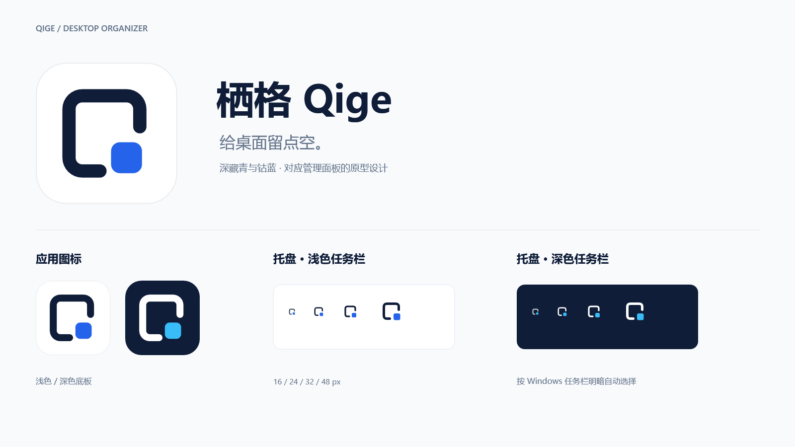

# 栖格 Qige

**给桌面留点空。** 面向 Windows 11 的轻量桌面分区整理工具。



当前版本为 **[v0.1.0-beta.6](https://github.com/LaoQiTX/Qige/releases/tag/v0.1.0-beta.6)**，小范围测试阶段。新增蓝白双模式管理面板，统一应用图标，并修复样例关闭后的托盘驻留。[运行效果与发布说明](docs/releases/v0.1.0-beta.6.md) · [更新记录](CHANGELOG.md)。

## 使用

将发布 ZIP 完整解压到固定、可写目录，双击 `DesktopGroups.exe`。标准包自带 .NET 运行时。首次可用“打开样例.cmd”体验，随后少量收纳真实桌面快捷方式。详见[使用说明](docs/user-guide.md)。

目前支持多个桌面整理抽屉，管理面板可新建、重命名、定位和安全移除抽屉，分别记忆位置、尺寸、折叠和锁定状态。支持边缘调整大小、自动排布与滚动、屏幕及相邻抽屉的边缘／中心吸附，按住 Alt 可临时绕过吸附。

支持个人桌面 `.lnk` / `.url`，已取消原有 12 项限制。保留整组移动、悬停折叠动画、图标高亮、拖回桌面解除分组、同目标快捷方式重建同步、托盘常驻和可选开机启动。正式模式与隔离样例关闭面板后均可收起到托盘；“退出并归还全部”真正退出，并归还全部抽屉内容。

文件夹映射抽屉、普通文件／文件夹、公共桌面入口、原生右键菜单和全桌面双击隐藏仍在后续规划中。真实 Explorer 重启、休眠、双屏插拔、混合 DPI 和长期共存仍需进一步验收。

## 数据存放

程序首次运行在 **exe 所在目录**创建唯一的数据目录 `QigeData`，与源码工作目录无关：

```text
安装目录/
├── DesktopGroups.exe
├── …运行时文件
├── 使用说明.md
└── QigeData/
    ├── config/       分区、成员与布局设置
    ├── storage/      已收纳快捷方式及历史版本
    ├── recovery/     会话锁、迁移及旧布局恢复依据
    ├── logs/         诊断记录
    ├── cache/temp/   程序临时文件
    └── samples/      样例数据
```

目录按需生成。快捷方式会**实际移动**，正常退出归还；异常退出后请从同一目录重启恢复。更新时先退出并归还，只替换程序文件，保留 `QigeData`。不覆盖冲突文件，不自动清理历史版本。

beta.1 用户在原可写目录放入新版程序后，首次运行会迁移原 `Data` / `Storage`，保留原配置备份及迁移记录；请勿再同时启动旧版。数据目录不可写时显示错误，不改用 C 盘或 AppData。不建议安装到需要管理员权限才能写入的 Program Files。

开发脚本使用项目内 `.local/QigeData`；测试、诊断分别使用 `.build` 下的隔离目录。程序可用绝对路径参数 `--data-dir` 指定开发数据位置。开机启动默认关闭，启用时登记当前用户启动项；Windows 自身的缓存和日志由系统管理。

## 开发与项目结构

C# / .NET 10、WPF 离屏绘制、Win32 分层桌面窗口、Windows Shell，无第三方 NuGet 业务依赖。在现有 PowerShell 7 中使用 .NET 10 SDK；构建脚本将可控缓存与临时文件定向到项目内。

```text
src/DesktopGroups/           正式应用：App / Desktop / Panels / Shell / Storage
tests/DesktopGroups.Tests/  隔离回归检查，不随正式程序发布
tools/DesktopGroups.Diagnostics/  桌面诊断与历史原型，不随正式程序发布
assets/brand/               品牌 SVG、应用 ICO、设计预览
scripts/                    构建、发布、品牌导出脚本
docs/                       当前说明、架构、历史设计与发布记录
.github/                    问题模板与 Windows 构建检查
Qige.slnx                   解决方案
.local/                     本机开发数据及归档（不提交）
.build/                     SDK 缓存、测试结果、临时输出（不提交）
artifacts/                  发布包与品牌导出（不提交）
```

```powershell
.\build.ps1                         # 编译完整解决方案
.\build.ps1 -Task Test              # 数据目录、迁移、收纳与冲突恢复
.\build.ps1 -Task Demo              # 本机隔离样例
.\build.ps1 -Task Run               # 使用 .local/QigeData 的真实桌面模式
.\build.ps1 -Task ResidentTest      # 托盘、单实例及模拟桌面恢复
.\build.ps1 -Task LayoutTest        # 多抽屉、恢复与布局吸附
.\build.ps1 -Task ManagerTest       # 隔离管理面板和预览导出
.\build.ps1 -Task StorageRenderTest # 面板、动画、OLE 与 120 次移动
.\build.ps1 -Task IconTest          # 快捷方式图标解析
.\publish.ps1                      # 自带运行时的 win-x64 ZIP 和 SHA256
pwsh -STA -File scripts/build-brand.ps1 # 导出到 artifacts/brand
```

桌面相关检查需在已登录的 Windows 桌面会话运行；CI 只运行不依赖交互桌面的数据检查。发布输出在 `artifacts/releases`，仅打包正式应用和指定用户文档，不含个人数据、测试工具或开发缓存。

[抽屉产品规划](docs/drawer-types.md) · [后续规划](docs/roadmap.md) · [开发说明](docs/development.md) · [当前架构](docs/architecture.md) · [管理面板设计](docs/management-panel.md) · [品牌说明](docs/brand.md) · [历史文档](docs/history/README.md)

反馈请通过 Issues 提供复现步骤与系统环境。诊断含本机路径等信息，分享前先脱敏；不要上传个人快捷方式、整个 `QigeData` 或历史数据目录。本项目自行实现，不包含 Fences 的代码或资源。
