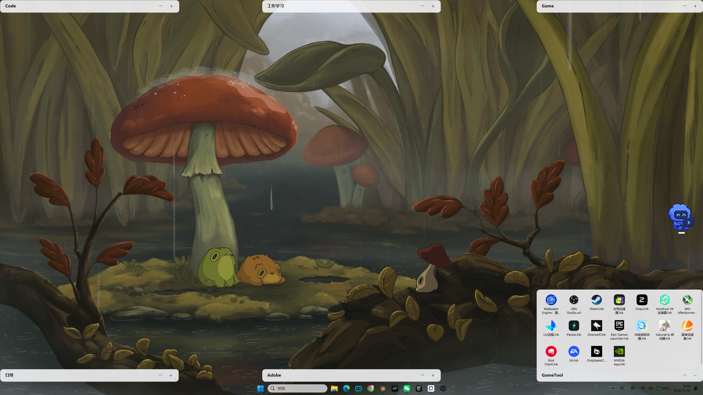
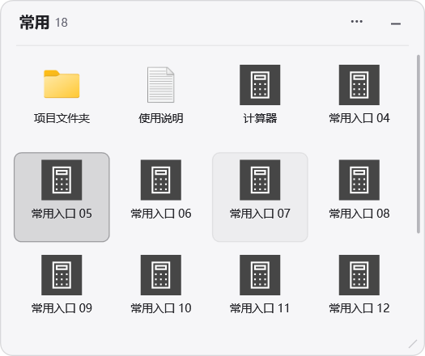
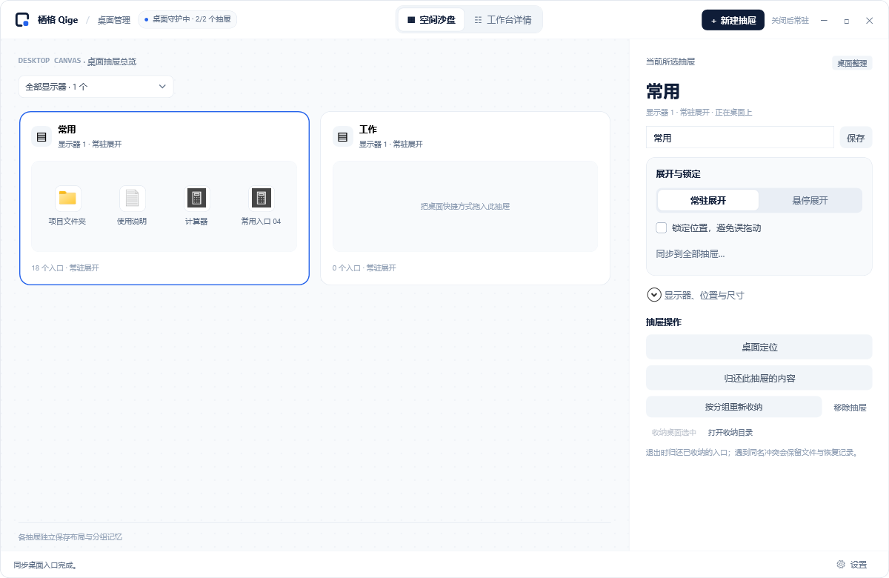
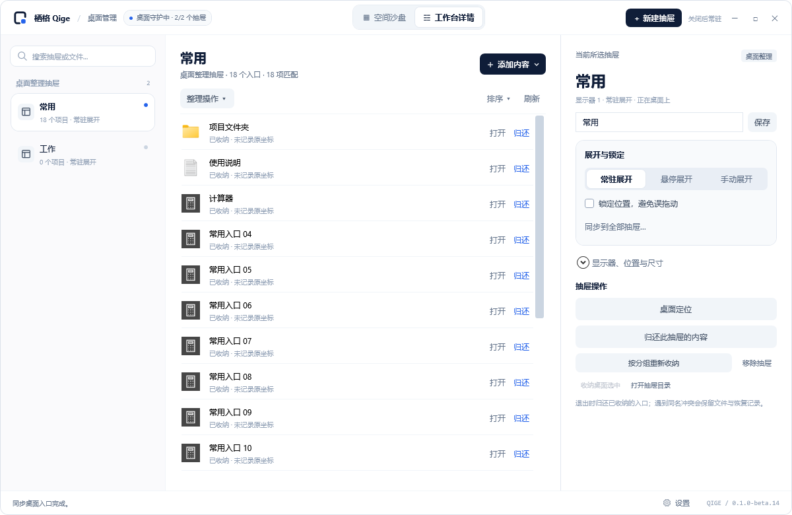
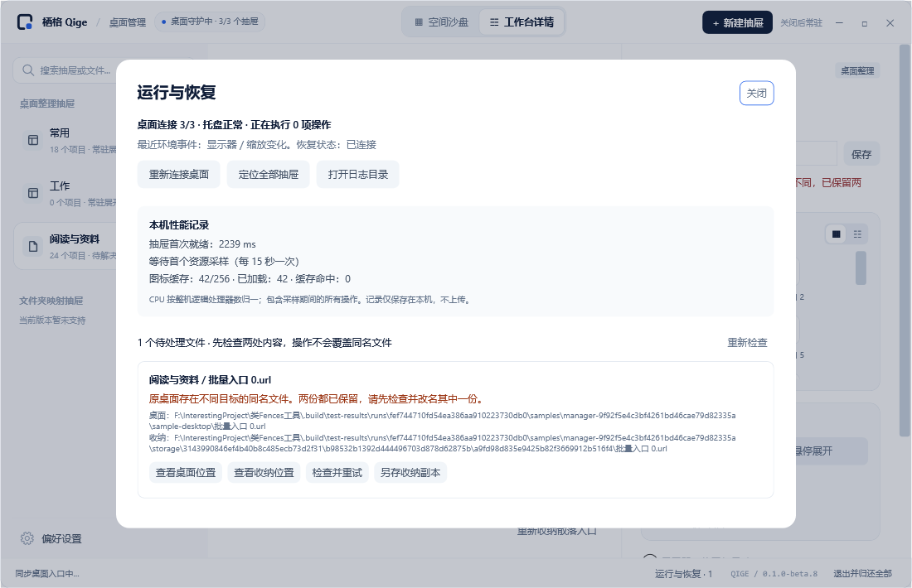

<p align="center">
  <picture>
    <source media="(prefers-color-scheme: dark)" srcset="assets/brand/qige-app-dark.svg">
    
  </picture>
</p>

<h1 align="center">栖格 Qige</h1>

<p align="center">
  <strong>给桌面留点空。</strong><br>
  用桌面抽屉整理文件、文件夹和快捷方式，也可以直接管理已有目录。
</p>

<p align="center">
  <a href="https://github.com/LaoQiTX/Qige/releases">下载公开版本</a> ·
  <a href="docs/user-guide.md">使用指南</a> ·
  <a href="docs/README.md">项目文档</a> ·
  <a href="docs/roadmap.md">开发计划</a> ·
  <a href="LICENSE">MIT 许可证</a> ·
  <a href="ASSET-ATTRIBUTION.md">资产声明</a> ·
  <a href="https://github.com/LaoQiTX/Qige/issues">反馈问题</a>
</p>

<p align="center">Windows 11 x64 · 安装包 / 便携版 · 中文界面</p>

[](docs/images/qige-desktop-showcase.png)

## 看看栖格

当前正式版为 v1.1.0，包含统一界面、主题设置和公共桌面实际收纳修复。功能和验收进度见 [v1.0.0 基本功能清单](docs/v1-basic-features.md)。

把个人或公共桌面上的文件、文件夹和快捷方式拖进抽屉，按工作、娱乐或自己的习惯分组。抽屉可以自由摆放、调整大小、吸附对齐，也能折叠成标题条，在鼠标移入时展开。

**桌面抽屉**

<p align="center">
  
</p>

**管理面板 · 空间沙盘**



<details>
<summary>查看工作台详情与运行恢复面板</summary>

<br>

**工作台详情** — 搜索入口、查看抽屉内容，调整名称、布局与展开方式。



**运行与恢复** — 查看连接与性能信息，定位冲突文件并重试归还。



</details>

以上为隔离样例截图。

## 能做什么

- **整理桌面**。收纳文件、文件夹和快捷方式，按用途分组。文件交给 Windows 关联程序打开。
- **映射已有目录**。显示和操作所选目录的直接子项，支持刷新和失效重定位。移除映射后原目录和文件保留。
- **引用外部项目**。从其他位置添加文件或文件夹入口，原件留在原处。
- **浏览和批量整理**。工作台支持滚轮、搜索、多选、排序和批量操作。删除实际文件前会确认，并使用 Windows 回收站。
- **布置抽屉**。移动、缩放、吸附、锁定位置，可选常驻、悬停和手动展开。
- **备份与恢复**。备份配置和托管内容，在「设置 → 运行与恢复」检查冲突和中断传输。关闭面板后可留在托盘，也可启用登录启动。

## 下载与开始使用

Windows 11 x64 的公开版本可在 [GitHub Releases](https://github.com/LaoQiTX/Qige/releases) 下载。版本差异见 [更新记录](CHANGELOG.md)。

| 形式 | 使用方式 |
| --- | --- |
| 安装包 `Qige-…-setup-win-x64.exe` | 通过中文向导选择可写目录，从开始菜单启动 |
| 便携包 `Qige-…-win-x64.zip` | 完整解压到固定、可写目录，运行 `Qige.exe` |

两种包均自带 .NET 运行时。首次可运行「打开样例.cmd」体验隔离样例。

1. 点「新建抽屉」，选择「桌面整理抽屉」或「文件夹映射抽屉」。
2. 整理抽屉可收纳个人或公共桌面项目。映射抽屉先选择目录，再确认创建。
3. 拖动标题或边缘调整布局，在标题「···」里查看项目数和展开设置。
4. 更新前选择「退出并归还全部」，备份并保留完整的 `QigeData`。

托管项目实际移入 `QigeData/storage`，归还时回到原个人或公共桌面位置。映射与外部引用由栖格记录路径。详细步骤见 [使用指南](docs/user-guide.md)。

## 文档

| 我想了解… | 文档 |
| --- | --- |
| 安装、整理桌面、管理抽屉 | [使用指南](docs/user-guide.md) |
| 冲突、找不到抽屉、恢复文件 | [问题排查](docs/troubleshooting.md) |
| 两类抽屉的行为与文件保护 | [产品规格](docs/product-spec.md) |
| 后续开发顺序 | [开发计划](docs/roadmap.md) |
| 技术原理、构建与发布 | [架构](docs/architecture.md) · [开发](docs/development.md) · [分发](docs/distribution.md) |
| 界面、图标与验证情况 | [设计](docs/design.md) · [验证](docs/validation.md) |

## 从源码运行

采用 C# / .NET 10、WPF、Win32 和 Windows Shell。需要 Windows 11 x64、PowerShell 7 和 .NET 10 SDK。

```powershell
.\build.ps1 -Configuration Release
.\build.ps1 -Task Demo -Configuration Release
```

开发数据、缓存和测试输出留在项目目录。完整命令见[开发说明](docs/development.md)。

## 反馈

请通过 [Issues](https://github.com/LaoQiTX/Qige/issues) 提供复现步骤、软件版本、Windows 版本和显示器缩放设置。分享日志前先处理其中的本机路径，不要上传个人快捷方式或整个数据目录。

栖格自行实现桌面整理功能，不包含 Fences 的代码或资源。
