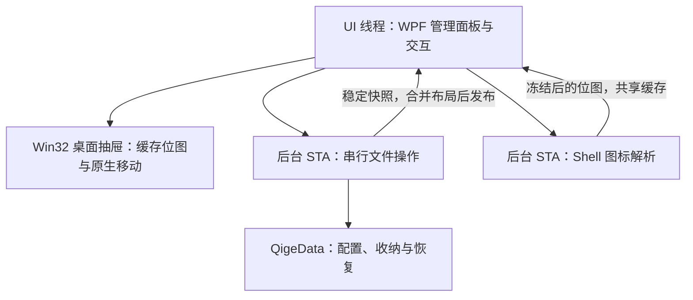

# 技术架构

栖格是单进程的 C# / .NET 10 Windows 应用。WPF 承担管理面板和离屏绘制，Win32 分层窗口显示桌面抽屉，Windows Shell 负责快捷方式与图标。

正式入口为 `Qige.exe`。源码目录、命名空间和测试项目沿用 `DesktopGroups`，不代表另一个应用。

## 模块

| 模块 | 主要职责 |
| --- | --- |
| `App` | 管理面板、托盘、单实例、启动项、后台队列与性能记录 |
| `Desktop` | Explorer 桌面挂接、显示器工作区、恢复调度和布局吸附 |
| `Panels` | 抽屉窗口、缓存位图、折叠动画、OLE 拖放与拖出反馈 |
| `Shell` | Unicode 快捷方式解析、图标资源解析和异步缓存 |
| `Storage` | 数据路径、抽屉目录、文件状态、校验搬移和恢复检查 |

测试和诊断工具独立于正式应用，不进入发布包。

## 线程与显示



桌面抽屉挂接在 Explorer 的桌面宿主下。WPF 不直接作为桌面子窗口参与合成，而是离屏绘出包含半透明底色、文字和不透明图标的位图。拖动通过原生窗口移动完成，不逐帧重新解析图标或挪动系统桌面图标；调整尺寸和内容变化时重建画面。

`StaWorkQueue` 将文件操作串行执行。每个抽屉忙碌时阻止重复文件操作，跨抽屉的路径预约避免同时收纳同一入口。后台使用独立模型，`ShortcutStore.Publish` 在 UI 线程发布结果，并合并期间修改的位置、大小、折叠和锁定。

`AsyncIconCache` 使用另一条 STA 队列，合并相同请求，FIFO 缓存最多 256 项。位图冻结后跨线程使用；内容签名阻止过期结果覆盖当前列表。管理面板和桌面抽屉共用这些图标。

## 数据目录

默认数据根为 `AppContext.BaseDirectory/QigeData`，与当前工作目录无关。开发运行通过绝对路径 `--data-dir` 使用项目内数据。

```text
QigeData/
├── config/
│   ├── drawers.json        抽屉目录、名称和全局设置
│   └── groups/<id>.json    各抽屉成员、文件阶段与布局
├── storage/<id>/          已收纳快捷方式和保留版本
├── recovery/              会话锁、恢复依据、移除归档与导出副本
├── logs/                  连接与本机性能记录
├── cache/temp/            可控临时文件
└── samples/               隔离样例
```

目录按需创建。`AppStorage.Resolve` 拒绝路径越界、绝对数据子路径、流语法和重解析点。JSON 使用同目录临时文件、刷新磁盘和原子替换。会话锁阻止同一套数据被多个正式实例操作；重复启动通过当前用户命名管道唤回窗口。

## 文件状态与恢复

`DrawerCatalog` 管理抽屉与路径所有权；每个抽屉由 `ShortcutStore` 保存原路径、收纳路径、快捷方式身份、SHA256、阶段和历史版本。

当前状态包括 `Collecting`、`Stored`、`Updating`、`Restoring`、`Restored`。`VerifiedTransfer` 锁定源文件，复制主内容和命名数据流、刷新并校验，持久化完整副本确认后才删除源文件。中断或冲突保留文件与依据，不能只凭相同主文件哈希删除不确定副本。

更新同步核对同一原路径的目标、参数及工作目录。移除抽屉先持久化意图，再后台归还，确认完成后归档和移除成员目录；单项拖出持久化解除分组意图，避免中断后重新收纳。

`RecoveryInspection` 对独立快照做只读检查，恢复面板展示文件阶段和两处路径。退出等待后台操作，归还失败保留程序和恢复入口。强制终止仍依赖下次启动恢复。

## 桌面环境与布局

位置保存为屏幕物理坐标，尺寸使用 DIP。按目标屏幕 DPI 换算，并约束在工作区内。屏幕与相邻抽屉的边缘、中心线参与吸附；进入 10 DIP、脱离 18 DIP，Alt 临时绕过。

环境消息合并 300 ms，2 秒看门狗检查连接与显示器拓扑；失败按 1、2、4、8、16、30 秒安排重试。拖动中推迟自动重排，临时回收不覆盖用户首选布局。目录监听异常时重建，并以约 30 秒的完整同步补偿事件丢失。

`PerformanceRecorder` 每 15 秒采样，最多保存 240 项。测量口径和当前验收边界见[验证说明](validation.md)。

当前文件层仅支持小型桌面快捷方式。普通文件和映射目录的操作层另见[产品规格](product-spec.md)，不能直接放宽现有搬移限制代替实现。
