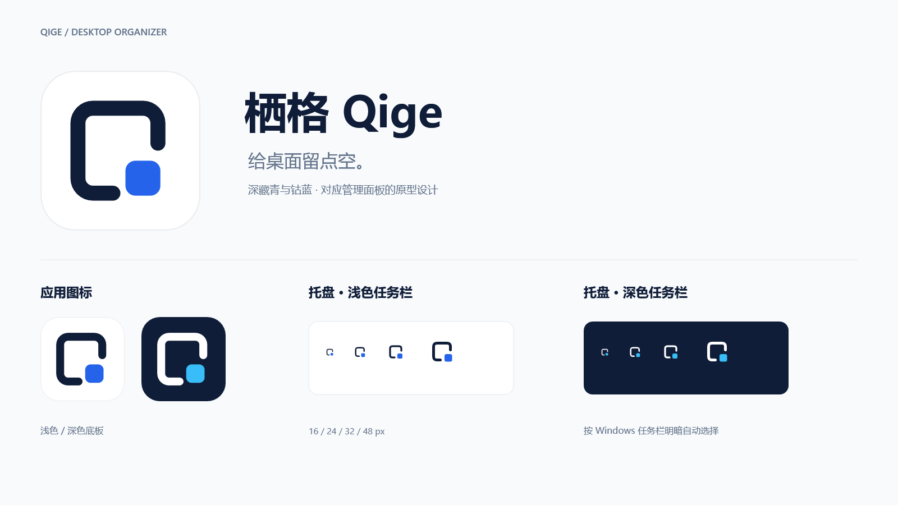

# 栖格 · Qige

应用名：栖格，读作 qī gé。品牌短句：**给桌面留点空。**

标志由开口的圆角收纳框与右下角的小方块组成，沿用 `docs/原型设计` 中的矢量设计。应用默认使用白色圆角底板、深藏青边框和钴蓝方块，另提供深色变体。小尺寸托盘按 16 像素网格单独绘制。

| 颜色 | 色值 | 用途 |
| --- | --- | --- |
| 深藏青 | #0F1D38 | 浅底标志、界面正文 |
| 钴蓝 | #2563EB | 浅底方块与强调色 |
| 天青 | #38BDF8 | 深底方块 |
| 白色 | #FFFFFF | 应用底板与深底标志 |

`assets/brand` 保存 SVG、应用与托盘 ICO、品牌元数据和预览。`qige.ico` 包含 16、20、24、32、40、48、64、128、256 像素；托盘 ICO 包含 16–64 像素。

`qige-tray-light.ico` 使用浅色描边，适用于深色任务栏；`qige-tray-dark.ico` 使用深色描边，适用于浅色任务栏。程序启动时读取 Windows 任务栏明暗设置，选择对应资源。

执行 `pwsh -STA -File scripts/build-brand.ps1 -UpdateAssets` 可重新导出规范素材。各尺寸 PNG 和额外变体生成到 `artifacts/brand`，不引入新依赖。

