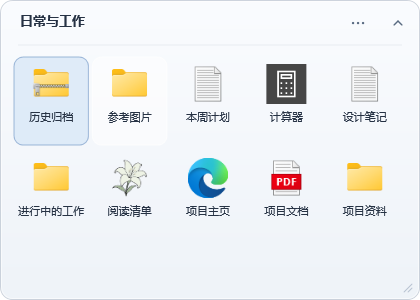
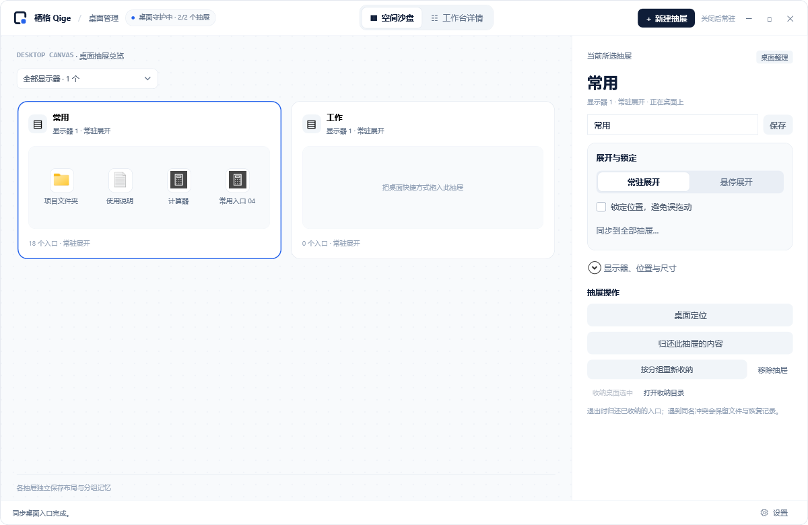

# 设计说明

应用名为**栖格 Qige**，读作 qī gé，短句为“给桌面留点空。”。界面采用白色与浅灰背景、深色文字和蓝色强调，优先保证入口清晰和操作流畅。

## 应用与托盘图标

  
  

标志由开口圆角框和右下独立方块组成。应用图标使用圆角底板，托盘图标为小尺寸单独绘制。

| 素材 | 位置与用途 |
| --- | --- |
| `qige.ico` | `assets/brand`；应用、窗口和安装器图标 |
| `qige-app.svg` / `qige-app-dark.svg` | 浅色/深色应用图标源文件 |
| `qige-mark-dark.svg` / `qige-mark-light.svg` | 对应浅底/深底的独立标志 |
| `qige-tray-dark.ico` / `qige-tray-light.ico` | 对应浅色/深色 Windows 任务栏 |
| `qige-wordmark.svg` / `brand.json` | 组合标志与名称、颜色等元数据 |

应用 ICO 包含 16–256 像素的多档资源，托盘 ICO 包含 16–64 像素。启动时按任务栏明暗选择托盘变体。品牌素材以 `assets/brand` 为唯一来源。

| 颜色 | 色值 | 用途 |
| --- | --- | --- |
| 深色 | #0F1D38 | 正文、图标轮廓 |
| 蓝色 | #2563EB | 主要操作与强调 |
| 天青 | #38BDF8 | 深色图标强调 |
| 白色 | #FFFFFF | 应用底板与主要界面 |

## 桌面抽屉

现有浅色抽屉已完成第一轮“素简”美化：冷白半透明底色带轻微纵向层次，外沿细边框与内侧亮边形成轮廓；标题使用 13 DIP 半粗字，更多菜单改为矢量圆点，折叠按钮改为方向箭头。数量仍在标题设置菜单展示。

图标保留原色和不透明度；悬停使用浅白底，选中使用淡蓝底和蓝灰边框，避免两种状态混淆。滚动条和缩放手柄降低视觉权重，空抽屉显示居中的拖入提示。按钮仅在悬停状态变化时重绘，不增加持续动画或背景模糊。折叠只改变可见高度，不改变内容或所有权。

背景透明度可按抽屉调节，范围 0–80%，默认 12%，标题菜单、标题右键与管理面板参数区共用设置，支持选择同步。滑杆实时预览，拖动结束保存，文字和图标保持不透明。抽屉菜单按逻辑层级计算背景：每层透明度减半，底色由冷白逐层加深为蓝灰；只改变背景画刷，不降低整个菜单的 Opacity。所有 Popup 显式绑定所属层级画刷，避免脱离视觉树后取错值。

本轮通过原有 StorageRenderTest，覆盖移动缓存、选择/悬停、展开/折叠、向上展开、密度、尺寸调整与 OLE 拖放；另检查空抽屉、244 × 160 最小尺寸和长标题。隔离样例不操作真实桌面文件。

透明度增量通过 StorageRenderTest、ManagerTest 和 P0Test：覆盖透明/不透明档位、旧配置默认值、异常值限制、所有参数入口、菜单实时联动与三层背景、恢复默认、按字段同步，以及后台任务发布结果时保留 UI 修改。ManagerTest 通过 127 项检查；渲染回归 120 次移动无位图重建。

拖动保持一整张缓存画面移动。折叠动画即时触发；吸附出现辅助线，Alt 可随时绕过。文件操作不能依赖“看起来移动了”代替实际完成反馈。

## 管理面板

| 区域 | 职责 |
| --- | --- |
| 顶栏 | 标志、连接状态、双模式切换、新建与窗口控制 |
| 空间沙盘 | 抽屉卡片、显示器筛选、内容预览与选择 |
| 工作台详情 | 类型分组、名称/入口搜索、列表内容及归还 |
| 属性检查器 | 当前抽屉的名称、展开、锁定、几何参数与操作 |
| 底栏 | 状态与统一设置入口 |

两种主模式共用当前选择。未实现的映射类型显示说明，不提供可点击却无后端的功能。窗口默认 1200 × 780，最小 1100 × 710；内容与属性区可滚动。

运行与恢复面板展示连接、任务、性能和冲突文件。错误应说明结果与下一步：两处文件在哪里、哪些操作仍未完成、何时可以重试。

统一设置承载通用设置、运行与恢复、关于与帮助。全局吸附不再放在单个抽屉属性中；右侧不重复展示第三份内容列表，也不提供额外的内容视图切换。单抽屉操作集中于共享属性区，全部抽屉操作位于设置。后续入口去重及双视图设计见 [开发计划](roadmap.md#后续版本--管理面板设计与交互)。

## 统一控件规范

基础单位为 DIP。正文使用 Segoe UI 和 Microsoft YaHei UI，常用正文 12，辅助说明 10–11，菜单标题 13，弹窗标题 17。常用留白按 6、8、12、16、20 DIP 选择。按钮与输入框至少 30 DIP 高，菜单项至少 34 DIP。紧凑的行内按钮与标题图标沿用所在行的对齐规则。

| 部件 | 默认样式 | 反馈 |
| --- | --- | --- |
| 按钮 | 次要操作用浅底，当前任务的确认按钮用蓝底，行内操作用透明底 | 悬停、按下改变背景而保留文字对比；键盘焦点用独立内框；禁用使用专用前景和底色 |
| 输入框 | 浅底细边，标签随输入框放置 | 悬停和焦点显示边框，错误用红边及就近文字说明，更正后清除；只读使用独立底色 |
| 列表、类型卡和切换项 | 轻量边界和稳定尺寸 | 悬停改变底色，选中保留标记，键盘焦点仍可辨认 |
| 菜单和弹窗 | 使用相同正文、色板和操作顺序，确认靠近所属表单 | 菜单用勾选、悬停、焦点和禁用分别反馈；抽屉菜单沿用逐层加深的透明度；弹窗把可修正的错误留在上下文内 |

共用样式见 [SharedControls.xaml](../src/DesktopGroups/App/SharedControls.xaml)，界面颜色见 [AppPalette](../src/DesktopGroups/App/AppPalette.cs)。桌面抽屉保留透明材质需要的独立色板和冻结画刷，其文字、强调色及状态层次与管理面板一致。

## 下一轮优先 · 命名主题与纯净抽屉

2026-11-20 需求更新，下一轮优先推进完整主题，并行建立毛玻璃和卡片加入前的性能基线。当前仅完成上述浅色抽屉美化；命名主题选择、暗色、跟随系统及雾映材质仍待实现。

| 主题名 | 视觉方向 | 配色模式 |
| --- | --- | --- |
| 素简 | 优化现有简洁界面，统一留白、排版、控件比例、边框与交互反馈 | 亮色 / 暗色 / 跟随系统 |
| 雾映 | 模拟 Win11 原生毛玻璃，背景模糊、半透明底色、细边框与柔和阴影，前景文字和图标清晰 | 亮色 / 暗色 / 跟随系统 |

主题风格与明暗选择独立保存。两套主题都覆盖抽屉、管理面板、菜单和二级窗口；系统切换只影响“跟随系统”，不能覆盖手动选择。毛玻璃实现需与现有桌面窗口验证兼容性，低开销底色作为同主题降级；静止不持续生成动画帧。

纯净抽屉隐藏整条标题区域并回收空间；以 Alt+拖动空白处移动，保留缩放、吸附、锁定与恢复标题入口。标题隐藏时保持内容展开并记忆原展开方式，合并成员仍可从菜单切换。

“贴屏边角使用直角”作为独立开关：贴左边仅左侧两角变直，贴上边仅上侧两角变直，贴角时取并集，内部角保持主题圆角；移开恢复。按当前屏幕外侧桌面可用边界判断，考虑任务栏、DPI 和多屏接缝。绘制、边框、裁剪和命中使用相同轮廓。

完整任务与组合验收见[开发计划](roadmap.md)。

## 素材与实现

[管理面板交互参考](../assets/design/management-panel.html) 供设计沟通使用，依赖在线样式资源，不能作为功能完成依据。实际可用范围见[使用指南](user-guide.md)。

WPF 布局位于 `StorageWindow.xaml`，交互位于相应 partial 类；桌面抽屉通过 `DrawerAppearance` 共享冻结的画刷，与管理面板配色分离。应用运行无需下载浏览器组件、字体或设计原型资源。

运行截图集中于 `docs/images`，均来自隔离样例。品牌导出命令见[开发说明](development.md)，本地预览画板不作为 README 展示图。
