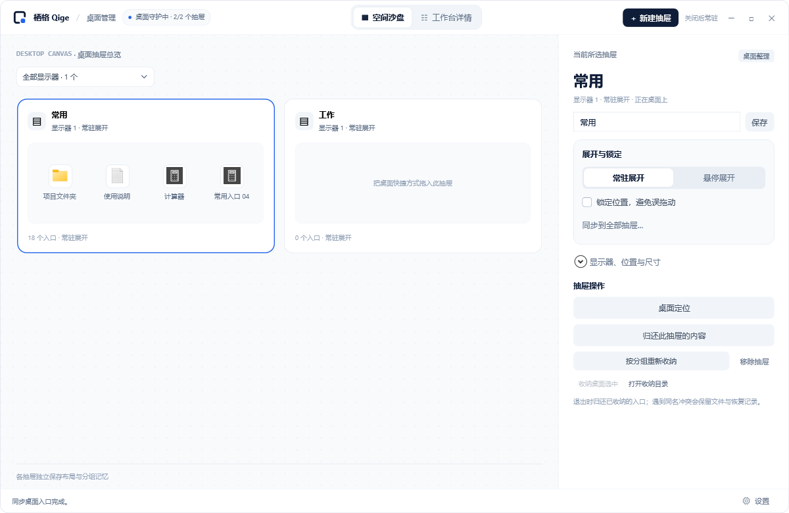

# 设计说明

应用名为**栖格 Qige**，读作 qī gé，短句为“给桌面留点空。”。界面采用白色与浅灰背景、深色文字和蓝色强调，优先保证入口清晰和操作流畅。

## 应用与托盘图标

  
  

标志由开口圆角框和右下独立方块组成。应用图标使用圆角底板，托盘图标为小尺寸单独绘制。

| 素材 | 位置与用途 |
| --- | --- |
| `qige.ico` | `assets/brand`；应用、窗口和安装器图标 |
| `qige-app.svg` / `qige-app-dark.svg` | 浅色/深色应用图标源文件 |
| `qige-mark-dark.svg` / `qige-mark-light.svg` | 对应浅底/深底的独立标志 |
| `qige-tray-dark.ico` / `qige-tray-light.ico` | 对应浅色/深色 Windows 任务栏 |
| `qige-wordmark.svg` / `brand.json` | 组合标志与名称、颜色等元数据 |

应用 ICO 包含 16–256 像素的多档资源，托盘 ICO 包含 16–64 像素。启动时按任务栏明暗选择托盘变体。品牌素材以 `assets/brand` 为唯一来源。

| 颜色 | 色值 | 用途 |
| --- | --- | --- |
| 深色 | #0F1D38 | 正文、图标轮廓 |
| 蓝色 | #2563EB | 主要操作与强调 |
| 天青 | #38BDF8 | 深色图标强调 |
| 白色 | #FFFFFF | 应用底板与主要界面 |

## 桌面抽屉

采用浅色半透明面板、清晰原色图标和细标题区域。悬停与选中分别反馈；标题包含名称、数量、管理入口和折叠操作。折叠只改变可见高度，不改变内容或所有权。

拖动保持一整张缓存画面移动。折叠动画即时触发；吸附出现辅助线，Alt 可随时绕过。文件操作不能依赖“看起来移动了”代替实际完成反馈。

## 管理面板

| 区域 | 职责 |
| --- | --- |
| 顶栏 | 标志、连接状态、双模式切换、新建与窗口控制 |
| 空间沙盘 | 抽屉卡片、显示器筛选、内容预览与选择 |
| 工作台详情 | 类型分组、名称/入口搜索、列表内容及归还 |
| 属性检查器 | 当前抽屉的名称、展开、锁定、几何参数与操作 |
| 底栏 | 状态与统一设置入口 |

两种主模式共用当前选择。未实现的映射类型显示说明，不提供可点击却无后端的功能。窗口默认 1200 × 780，最小 1100 × 710；内容与属性区可滚动。

运行与恢复面板展示连接、任务、性能和冲突文件。错误应说明结果与下一步：两处文件在哪里、哪些操作仍未完成、何时可以重试。

统一设置承载通用设置、运行与恢复、关于与帮助。全局吸附不再放在单个抽屉属性中；右侧不重复展示第三份内容列表，也不提供额外的内容视图切换。单抽屉操作集中于共享属性区，全部抽屉操作位于设置。具体入口审查见[界面入口审查](interface-audit.md)。

## 素材与实现

[管理面板交互参考](../assets/design/management-panel.html) 供设计沟通使用，依赖在线样式资源，不能作为功能完成依据。实际可用范围见[使用指南](user-guide.md)。

WPF 布局位于 `StorageWindow.xaml`，交互位于相应 partial 类；桌面绘制使用共享配色。应用运行无需下载浏览器组件、字体或设计原型资源。

运行截图集中于 `docs/images`，均来自隔离样例。品牌导出命令见[开发说明](development.md)，本地预览画板不作为 README 展示图。
