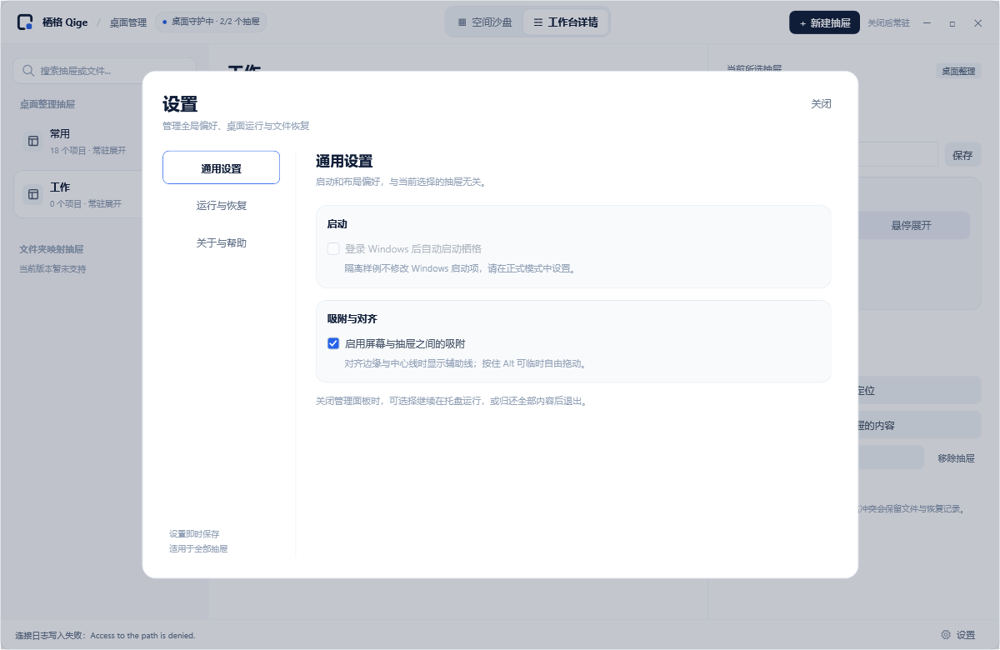

# 界面入口审查

beta.9 统一设置与操作分布，保留空间沙盘、工作台详情两种主视图。以下保留本地验收过程记录，最终内容已纳入 beta.9。

## 设置入口

管理面板底栏固定显示“设置”，不随主视图或当前抽屉选择变化。托盘“设置”和快捷键 `Ctrl+,` 打开同一设置界面。设置更改即时保存，关闭或 Esc 返回原主视图与抽屉。

| 设置页 | 职责 |
| --- | --- |
| 通用设置 | 登录启动、全局吸附与对齐 |
| 运行与恢复 | 连接、定位全部、全部归还与收纳、性能、日志及冲突处理 |
| 关于与帮助 | 版本、实际数据目录、使用指南与隔离样例 |

设置中的开关与操作均连接现有后端，不加入未实现的外观或文件夹映射开关。样例模式明确禁用登录启动。

## 重复入口处理

| 原分布或重复项 | 调整后 |
| --- | --- |
| 沙盘底部、工作台侧栏各有“偏好设置” | 合并为管理面板底栏的固定“设置” |
| 全局吸附混在单个抽屉“桌面物理行为”中 | 移入“设置 → 通用设置”，未选择抽屉也能修改 |
| 右侧“内容透视”重复主视图内容，还提供网格/列表两种预览 | 移除重复区域和切换代码；卡片保留预览，工作台保留完整内容列表 |
| 卡片、工作台、右侧重复定位和归还，工作台和右侧重复重新收纳 | 单个抽屉操作统一放右侧属性区，两种主视图共用 |
| 全局归还/重新收纳仅分散在托盘菜单 | 移入“设置 → 运行与恢复”，标明作用于全部抽屉 |
| 托盘同时有找回分区、定位全部、恢复、启动切换等多项入口 | 精简为打开管理面板、设置、退出并归还 |
| 顶部新建按钮之外，两个空状态继续重复新建按钮 | 新建操作仅保留顶部入口，空状态文字指向顶部 |
| 底栏退出与关闭面板选择重复 | 底栏只保留设置，关闭窗口仍可选择托盘运行或完全退出；托盘保留直接退出 |
| 隐藏的折叠复选框和可见的展开方式分段同时维护同一状态 | 删除隐藏控件，分段直接调用抽屉折叠逻辑 |

## 保留的不同作用域

- “归还此抽屉的内容”和“归还全部内容”分别处理当前抽屉与全部抽屉；均保留分组记忆。
- 工作台中的单项“归还”和拖回桌面会解除该项分组，语义不同于整组归还。
- “移除抽屉”在内容归还成功后移除抽屉，保留恢复历史。
- 几何参数内的屏幕布局小图用于精确位置预览和选取，不增加第三个内容浏览区。
- 管理面板和托盘共用设置；托盘保留独立入口，便于面板隐藏后直接访问。
- “同步到全部抽屉”集中在共享属性区，弹窗选择展开方式、锁定状态；不在两种主视图分别复制批量设置面板。
- 图标右键属于指向当前入口的就地操作，沿用工作台单项归还的后端与冲突保护；空白处右键仍回到管理面板。

这些区别以作用范围和文件结果解释，避免将所有“归还”按钮视为同一操作。

## 验证

管理面板回归覆盖：两主视图打开同一设置、关闭后保留选择、未选择抽屉时修改并保存全局吸附、样例禁用登录启动、关于页真实数据目录、设置中的全部归还与重新收纳，以及冲突列表与退出冲突自动进入设置恢复页。额外导出设置页面与最小窗口渲染，检查内容可见、滚动和操作可达性。

2026-11-10，Release 构建 0 警告、0 错误；管理面板 49 项检查通过，基础四组共 125 项断言、托盘与常驻 53 项检查通过。默认与最小窗口渲染已检查，恢复操作滚动可达。修复移除抽屉后的待处理数量残留，并在后台任务期间禁用设置中的全部归还/收纳操作。

包含本轮设置调整的本地包版本为 `0.1.0-beta.9-validation.2`，位于 `artifacts/releases` 与 `artifacts/installers`。之前的 `validation.1` 仅包含稳定性收尾，不含统一设置。

后续增量加入右下角可见斜线缩放、按字段选择的抽屉参数同步及图标右键菜单。2026-11-10 最终管理器回归为 71 项通过；基础四组 125 项断言通过，Release 构建 0 警告、0 错误。同步弹窗默认和最小窗口渲染均已检查。该阶段本地包为 `0.1.0-beta.9-validation.4`；此前源码默认版本为 beta.8，最终发行统一为 beta.9。

`validation.4` 的 ZIP、安装包 SHA256 均已核对；该安装包的 23 项本机隔离验收通过，覆盖安装、占用拒绝、升级、卸载、重装及数据保留。

## 图标右键菜单样式

菜单使用独立 WPF 资源字典，与管理面板共用白色、蓝灰文字和细分隔线的视觉方向。12 DIP 圆角外框、6 DIP 圆角操作项、统一线条图标与 36 DIP 最小行高，补齐悬停、键盘焦点和禁用反馈。文件名与操作分层，长名称截断并可悬停查看。固定菜单宽度，避免文件名长短改变操作位置。

渲染检查覆盖普通、焦点、禁用及长名称四种状态；菜单打开期间保持抽屉展开，关闭后的悬停恢复与归还操作仍使用原有逻辑。

样式修订对应本地包 `0.1.0-beta.9-validation.5`。Release 构建 0 警告、0 错误，71 项管理器回归通过；截图来自隔离样例实际渲染。

