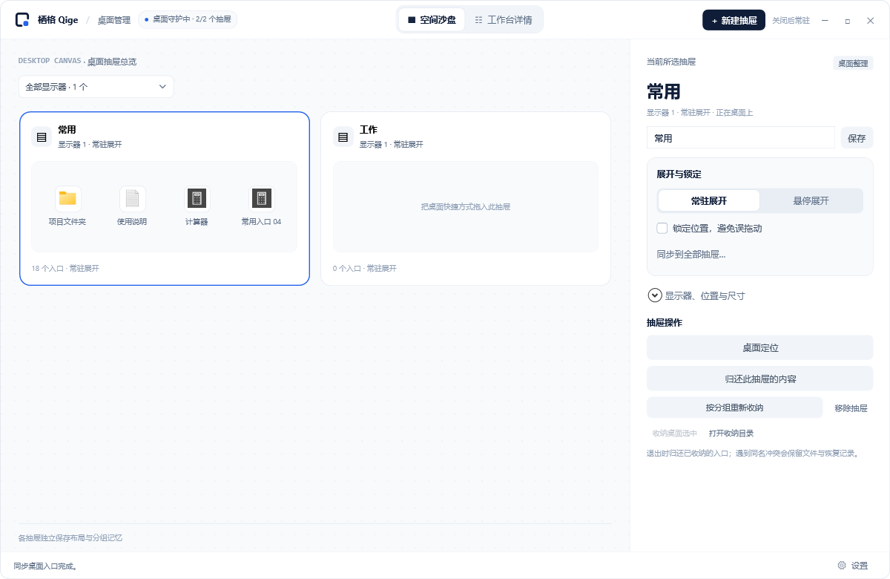

# 当前发布说明

## 栖格 Qige 0.1.0-beta.10

面向 Windows 11 x64 的预发布测试版，提供中文安装包和自带运行时的便携 ZIP。此次修复开机启动黑屏及桌面抽屉启动延迟；真实登录耗时仍待实机验收。[前往下载](https://github.com/LaoQiTX/Qige/releases/tag/v0.1.0-beta.10)。

### 本次更新

- 后台启动直接恢复托盘和抽屉，管理面板在第一次主动打开时显示，修复开机黑屏及需要再点托盘恢复的问题。
- 已开启的开机启动优先迁移到当前用户的交互登录任务，避开 Run 队列；保留原有关闭状态与修改过的入口，任务不可用时回退。
- 登录前 20 秒每约 300 毫秒重试桌面连接，抽屉优先于启动项迁移与图标解析；重复后台启动保持安静，重复打开不再初始化第二组抽屉。
- 卸载清理与安装路径及参数完全匹配的登录任务。

沿用 beta.9 的以下功能：

- 统一设置入口：底栏、托盘和 `Ctrl+,` 打开同一界面，按通用设置、运行与恢复、关于与帮助组织；合并主视图之外的重复功能。
- 抽屉参数可选择同步到全部抽屉：独立勾选展开方式、锁定状态，一次应用；名称、内容、位置与尺寸保持独立。
- 右下角可见灰色斜线可同时拖动宽高；悬停抽屉在调整大小、拖动滚动条期间保持展开，松开后恢复悬停判断。
- 图标右键提供打开、快捷方式所在位置、系统属性、归还桌面并解除分组、管理此抽屉；采用圆角白底、线条图标与清晰的悬停、焦点及禁用反馈。
- 连续环境通知不会无限推迟桌面恢复，失败退避不被重复通知重置；日志改为后台串行写入，故障时仍继续恢复桌面。
- 性能记录新增整次运行的累计统计，有界明细之外保留运行时长、平均 CPU、内存峰值和相对初始基线的变化。
- 安装包和便携包随附使用文档及图片，离线查看说明时可访问相对链接。

### 下载文件

| 文件 | 用途 |
| --- | --- |
| `Qige-0.1.0-beta.10-setup-win-x64.exe` | 中文安装包 |
| `Qige-0.1.0-beta.10-win-x64.zip` | 完整解压后运行 Qige.exe |
| 各自同名 `.sha256` | 下载校验 |

更新前在旧版选择退出并归还，备份并保留整个 `QigeData`。安装版沿用原安装目录；便携版使用完整新版文件。首次可以运行“打开样例.cmd”。

### 运行效果

[统一设置](images/settings.png) · [抽屉参数同步](images/preference-sync.png) · [图标右键菜单](images/drawer-item-menu.png) · [工作台详情](images/manager-studio.png)

### 验证与已知限制

Release 构建无警告和错误。基础四组共 147 项断言、管理器 74 项、托盘与常驻 62 项通过，补充实际 EXE 的后台/重复启动与首次主动打开检查；隔离样例未搬移真实桌面文件。登录任务经过唯一名称的临时任务登记、读取和删除验证，没有运行测试任务。卸载清理函数另经隔离 Inno 安装/卸载夹具验证：删除完全匹配的任务，保留参数已修改及其他安装目录的任务。beta.9 的安装器 23 项完整验收是历史记录，本次没有替换正在使用的安装。

只收纳个人桌面根目录 `.lnk` / `.url`。文件夹映射、普通文件/目录、公共桌面入口、跨抽屉拖放、完整 Explorer 扩展菜单及全桌面双击隐藏尚未开放。样式定制与抽屉标题“···”二级菜单留待后续。

真实 Explorer 重启、锁屏/唤醒、多屏插拔与混合 DPI、真实登录启动、至少 8 小时共存运行及干净 Windows 安装仍需实机验收；本版继续标记为预发布。详见[验证说明](validation.md)、[稳定性验收](stability-validation.md)和[正式版就绪评估](release-readiness.md)。

完整历史更新记录见 [CHANGELOG](../CHANGELOG.md)，历史安装文件见 [GitHub Releases](https://github.com/LaoQiTX/Qige/releases)。
