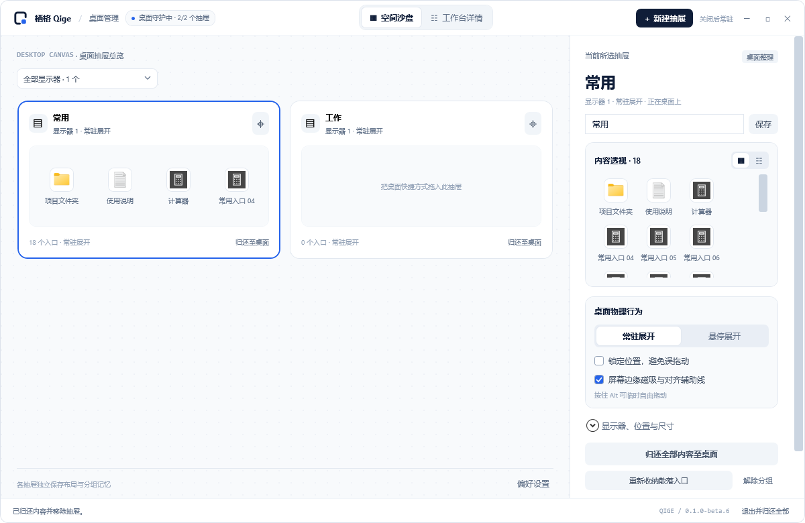
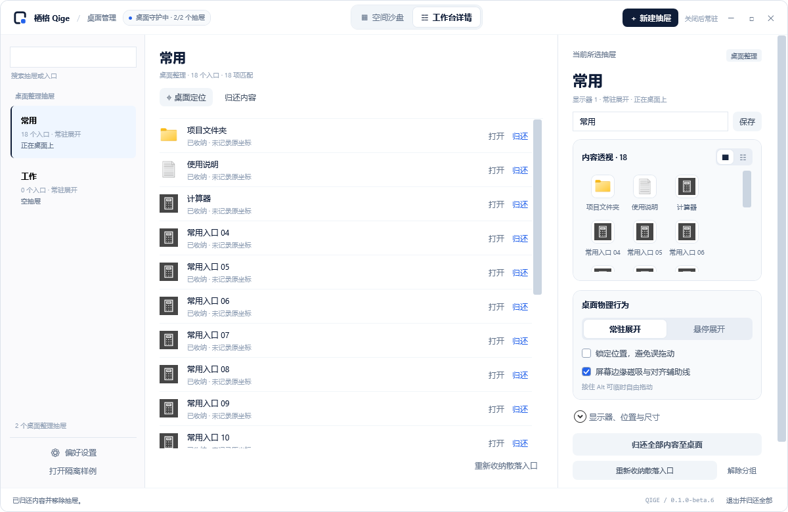
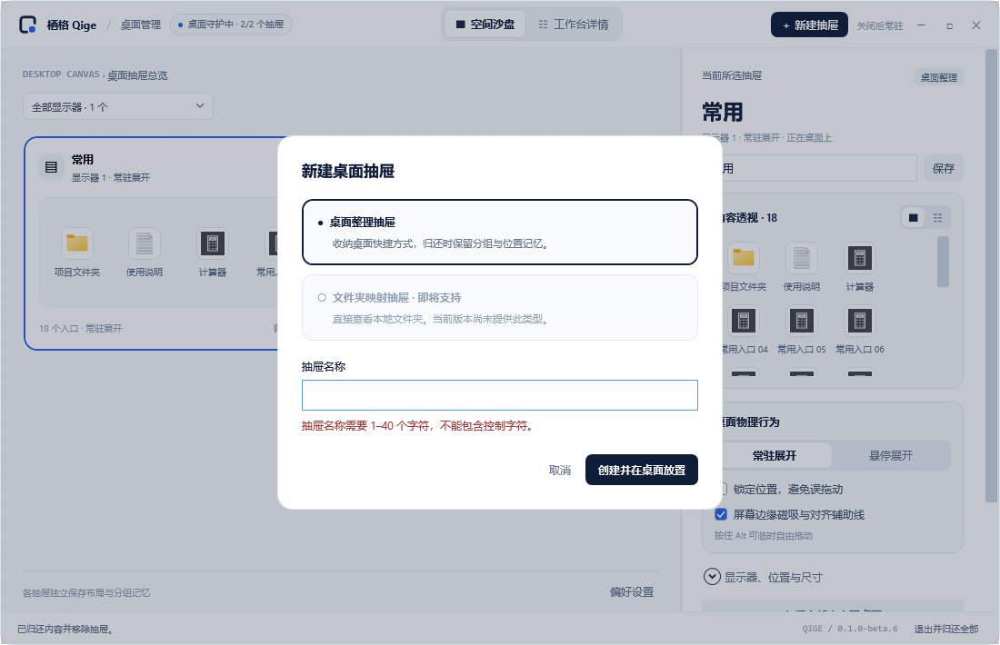
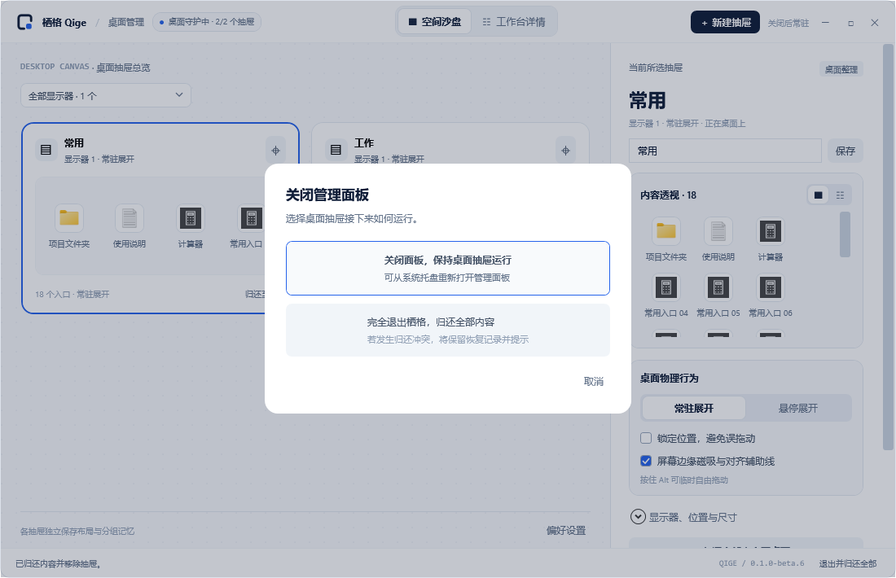
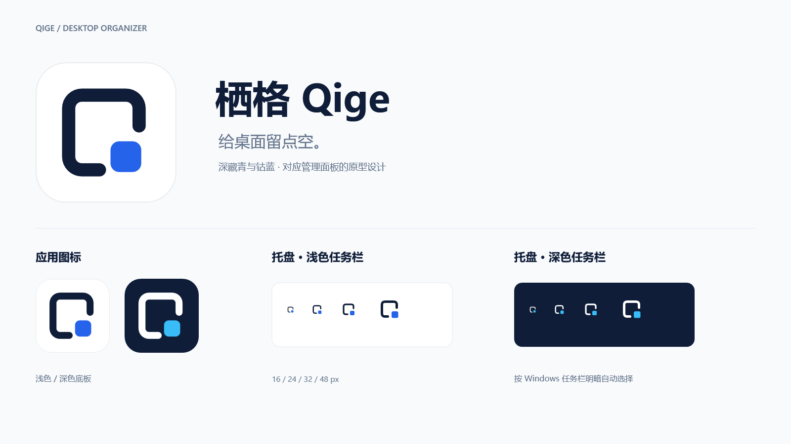

# 栖格 Qige v0.1.0-beta.6

本版重写桌面抽屉管理面板，新增空间沙盘与工作台详情双模式，统一蓝白应用图标，并修复样例模式关闭后未进入系统托盘的问题。包含此前 beta.2–beta.5 尚未正式发布的多抽屉、布局调整和数据目录改进。

Windows 11 x64 测试版。标准 ZIP 自带 .NET 10 运行时，完整解压后运行 `DesktopGroups.exe`。

## 主要变化

- 管理面板采用深藏青、钴蓝与白色，顶部切换空间沙盘和工作台详情；保留工作台左侧抽屉导航与搜索。
- 空间沙盘显示真实抽屉、图标预览与显示器筛选；共用右侧属性区编辑名称、折叠、锁定、吸附、显示器、位置和尺寸。
- 应用 exe、窗口图标和托盘资源统一为设计稿标志，应用 ICO 包含 16–256 像素多尺寸，托盘适配 Windows 浅色和深色任务栏。
- 正式模式和隔离样例均支持关闭面板后留在系统托盘，抽屉持续运行。双击托盘图标重新打开；右键提供归还、重新收纳和退出入口。样例禁用登录启动设置。
- 多抽屉分别记忆布局和分组；支持调整大小、内容滚动、屏幕与相邻抽屉吸附，按住 Alt 临时自由拖动。
- 单项归还解除该项分组，整抽屉归还保留分组记忆；遇到同名冲突保留文件与恢复记录，退出归还失败时保持管理面板可访问。

## 运行效果

以下为 Release 配置下隔离样例的运行界面导出，样例使用项目内独立数据，没有收纳真实桌面文件。

### 空间沙盘



### 工作台详情



### 新建抽屉



### 关闭与托盘常驻

点击关闭后选择“关闭面板，保持桌面抽屉运行”。Windows 若把图标折叠在右下角的“显示隐藏的图标”中，可展开查看或将栖格拖到可见区。



### 新版应用与托盘标志

这是图标资源预览，展示应用图标与托盘图标在不同底色下的外观。



## 下载与升级

- `Qige-0.1.0-beta.6-win-x64.zip`：自带运行时的 Windows x64 便携包。
- 同名 `.zip.sha256`：下载校验文件，可用 `Get-FileHash -Algorithm SHA256` 核对。
- 更新前从托盘选择退出并归还，保留原来的 `QigeData`，再替换程序文件；不要覆盖或删除数据目录。
- beta.1 的旧目录会在首次使用新版时迁移；请先退出旧版，并保留原目录备份。
- 首次可使用“打开样例.cmd”试用；样例现在也会留在托盘，需要通过“退出并归还全部”真正退出。

## 验证

- Release 编译：零警告、零错误。
- 管理面板：31 项检查，包括搜索与选择同步、图标预览、归还冲突、关闭后托盘驻留、重新打开及退出归还。
- 原生常驻：28 项检查，包括托盘注册、托盘打开事件、任务栏重建通知恢复、单实例唤回和隔离桌面恢复。
- 数据目录、迁移、文件恢复、所有权、多抽屉和布局吸附回归通过。
- 打包过程排除个人数据、快捷方式、开发缓存、测试工具和凭据。

跨机器的真实 Explorer 重启、休眠、多屏插拔、混合 DPI 和长期运行仍需继续实测。

## 当前范围

支持个人桌面的 `.lnk` / `.url` 快捷方式。文件夹映射、普通文件／文件夹收纳、公共桌面入口、原生右键菜单、桌面双击隐藏和全屏自动隐藏尚未实现。
## SHA256

```text
0f01318e173384c813f1e82135ced525bdd681d7ce124656d9e24175b4fc6f94  Qige-0.1.0-beta.6-win-x64.zip
```
