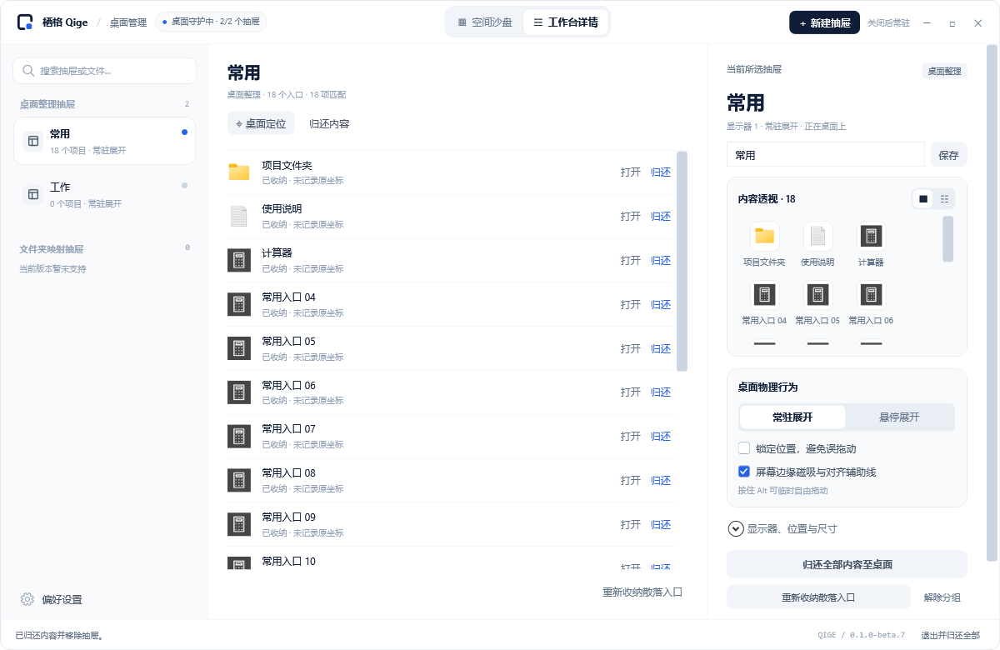
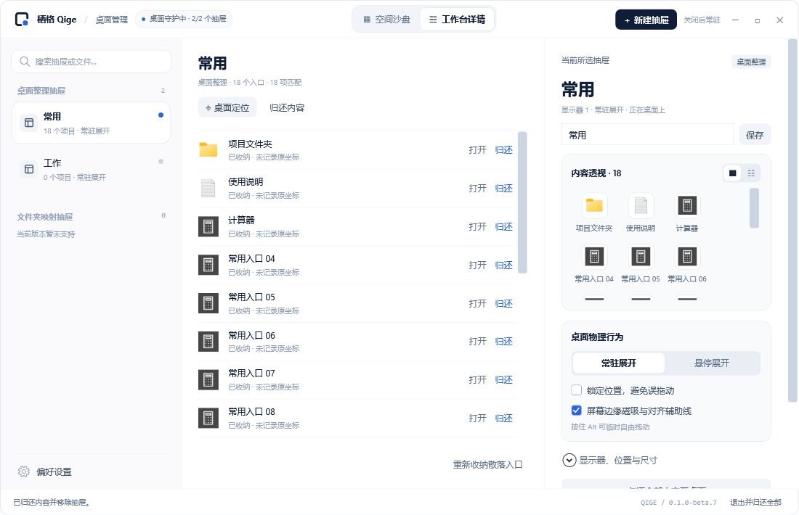

# 栖格 Qige v0.1.0-beta.7

本版按设计稿调整工作台详情左侧导航。Windows 11 x64 测试版，便携 ZIP 自带 .NET 10 运行时，完整解压后运行 `DesktopGroups.exe`。

## 主要变化

- 搜索框增加放大镜、圆角边框与框内提示，支持抽屉名称或入口名称搜索，无结果时显示提示。
- 左侧按抽屉类型分组，标题右侧显示实际数量；抽屉行包含小图标、名称、项目数和展开方式。
- 选中抽屉使用白色圆角卡片、细边框、加粗名称和蓝色状态点；需要检查时显示状态标记。
- 偏好设置固定在侧栏底部，分隔线与间距对应设计稿。
- 文件夹映射尚未实现，分组显示 0 和说明；没有加入虚构数据。
- 修正折叠高度检查，使其适应当前显示缩放。

## 运行效果

以下为 Release 配置的隔离样例运行截图，未收纳真实桌面文件。

### 工作台详情

### 最小窗口

## 下载与升级

- `Qige-0.1.0-beta.7-win-x64.zip`：自带运行时的 Windows x64 便携包。
- 同名 `.zip.sha256`：下载校验文件。
- 更新前从托盘选择退出并归还，保留 `QigeData`，再替换程序文件；不要覆盖或删除数据目录。
- 可运行“打开样例.cmd”试用。样例关闭后也会留在系统托盘，通过“退出并归还全部”结束。

## 验证

- Release 编译与管理面板 31 项检查通过，包含搜索、选择同步、创建与移除、归还冲突、托盘驻留和重新打开。
- 文件安全、收纳与布局回归通过。
- 默认窗口和最小窗口截图已核对。

文件夹映射与普通文件收纳仍未实现，功能范围与 beta.6 相同。
