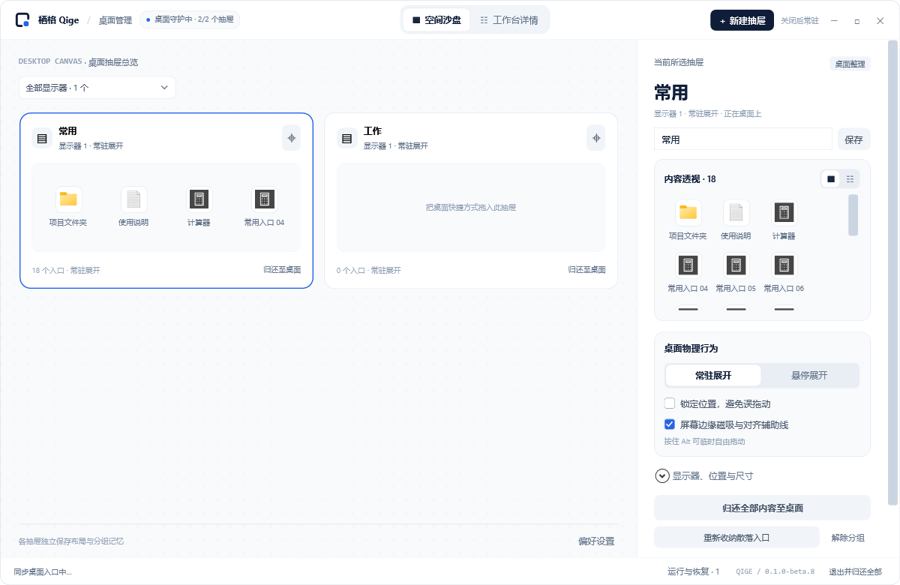
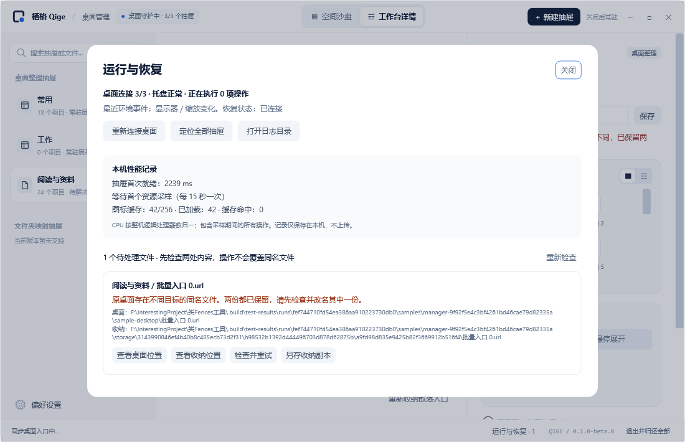

# 栖格 Qige v0.1.0-beta.8

Windows 11 x64 测试版。本版完成三个 P0 的功能实现，提供中文安装包和自带 .NET 10 运行时的便携 ZIP。程序入口统一为 `Qige.exe`。

## 主要变化

- 桌面生命周期恢复：合并显示变化、解锁、唤醒及 Explorer 重建事件，连接失败退避重试；目录监听重建与低频完整同步补偿事件丢失。
- 多屏布局：自动回收位置与大小时保留用户原布局，显示器接回后尝试恢复；用户主动调整则保存新布局。
- 新增“运行与恢复”面板及托盘入口：查看连接、后台任务、冲突/待完成文件、桌面与收纳两处位置，支持检查重试和校验另存副本。
- 收纳、同步、归还改用后台 STA 队列；后台结果合并期间的布局修改。退出等待已排队的文件操作；归还冲突会保留文件并打开恢复面板。
- 图标后台解析，抽屉与管理面板共享最多 256 项缓存，合并重复请求；每 15 秒记录本机 CPU、内存、UI 调度与绘制信息，最多保留 240 个样本，不上传。
- 中文安装向导允许选择可写目录，应用数据保存在该目录内的 `QigeData`；升级和卸载保留数据，并保护运行中的程序与会话。

## 运行效果

以下为隔离样例测试导出的界面，未收纳真实桌面文件。

## 下载与升级

| 文件 | 用途 |
| --- | --- |
| `Qige-0.1.0-beta.8-setup-win-x64.exe` | 中文安装包，自带运行时 |
| `Qige-0.1.0-beta.8-win-x64.zip` | 便携包，完整解压后运行 Qige.exe |
| 各自同名 `.sha256` | SHA256 下载校验 |

更新前在旧版中选择“退出并归还全部”，备份并保留 `QigeData`。安装版沿用原安装目录；从旧版便携包升级时，建议将完整新版解压到新目录并保留旧数据备份，再将整份 `QigeData` 迁入。不要只移动 EXE，也不要将两套数据合并或同时运行旧新版。可先运行“打开样例.cmd”试用。

## 验证与限制

Release 构建 0 错误、0 警告。数据/存储/布局/P0、管理面板、托盘与隔离宿主恢复、绘制/OLE、图标检查通过。覆盖 24 项后台收纳、操作期间修改布局、冲突重试、待收纳任务退出归还、20 次隔离宿主重建、120 次无位图重建的移动，以及后台拖放排队期间不要求 Shell 删除源文件。

已采集 30 秒隐藏面板的隔离测试宿主基线。它不代表发行 EXE 的冷启动、端到端帧率或长期内存结论。实际休眠/唤醒、Explorer 重启、显示器插拔/混合 DPI、真实登录启动及与 Wallpaper Engine/Pogget 长期共存仍需实机验收。详见 [P0 实现与验收](../p0-validation.md)。

当前仍只收纳个人桌面根目录 `.lnk` / `.url`。文件夹映射、普通文件/文件夹、公共桌面入口、跨抽屉拖放、原生右键菜单和全桌面双击隐藏尚未实现。
