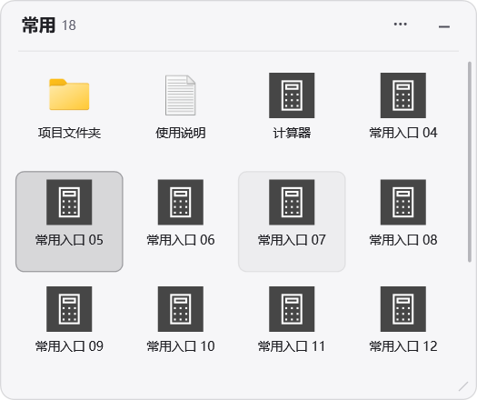
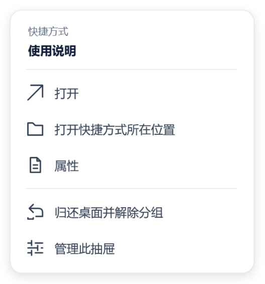

# 使用指南

栖格通过桌面抽屉整理个人桌面快捷方式。当前版本支持 Windows 11 x64 和个人桌面根目录的 `.lnk`、`.url`，每个入口不超过 4 MB。

本指南对应 0.1.0-beta.9，包含统一设置、参数同步和图标右键菜单。

## 安装与首次使用

在 [Releases](https://github.com/LaoQiTX/Qige/releases/tag/v0.1.0-beta.9) 选择安装包或便携 ZIP，两者均自带 .NET 运行时。

- **安装包**：选择固定、可写目录，完成后从开始菜单启动。开始菜单同时提供数据文件夹入口。
- **便携包**：完整解压后运行 `Qige.exe`。不要在压缩包内直接运行，也不要只复制 EXE。
- **先体验**：运行“打开样例.cmd”。样例使用独立文件，关闭面板后也会留在托盘，需要选择退出才结束。

程序会在 EXE 所在目录下创建 `QigeData`。请选择自己拥有写入权限的位置，例如 `F:\Apps\Qige`。

## 整理桌面

1. 在管理面板中新建抽屉，输入 1–40 个字符的名称。
2. 将个人桌面的快捷方式拖入，或先在桌面选中，再点击“收纳桌面选中”。
3. 使用“桌面定位”找到抽屉，拖动标题调整位置。
4. 单击图标选中，双击打开。拖回桌面空白处可归还文件并解除该项分组，下次不再自动收纳。

快捷方式会实际移动到 `QigeData/storage`。引用目标不随快捷方式搬移。公共桌面入口、普通文件、文件夹以及其他位置的文件当前不收纳。

## 布局与展开方式

| 操作 | 结果 |
| --- | --- |
| 拖标题 | 移动整个抽屉 |
| 拖边缘或角 | 调整大小，图标重新排布 |
| 拖右下角灰色斜线 | 同时调整宽度和高度；锁定时禁用 |
| 滚轮或右侧滚动条 | 查看超出可见区域的内容 |
| 选择“悬停展开” | 折叠保留标题，移入展开、离开收起 |
| 拖文件到折叠标题 | 展开并接受符合条件的快捷方式 |
| 开启吸附 | 靠近屏幕或相邻抽屉的边缘、中心线时对齐 |
| 按住 Alt | 临时绕过吸附 |
| 锁定位置 | 禁止移动和调整大小，仍可打开、滚动、折叠 |

位置、尺寸、折叠和锁定分别保存。可以在管理面板直接编辑位置和宽高；尺寸受当前显示器工作区约束。

拖动边框调整大小期间保持悬停抽屉展开，即使鼠标暂时离开边界也不会收起。松开后，鼠标在抽屉内则继续展开，移出后恢复自动折叠。

在属性区修改当前抽屉后，点击“同步到全部抽屉…”，勾选展开方式、锁定状态中的一项或两项，再确认应用到其余抽屉。这是一次复制：以后更改仍只影响当前抽屉，新建抽屉也不自动继承。名称、内容、显示器、位置与尺寸不参与同步。文件操作或拖动尚未结束时，等待完成后再同步。外观样式尚未开放，后续样式选项会接入同一同步入口。

显示器断开时，抽屉尝试临时回到可见屏幕，保留原布局供接回后恢复。主动拖动或修改布局会保存新的位置。

## 图标右键

右键点击抽屉内的快捷方式，菜单针对指向的图标提供“打开”“打开快捷方式所在位置”“属性”“归还桌面并解除分组”和“管理此抽屉”。所在位置指实际收纳文件的目录；属性调用 Windows 的快捷方式属性。归还只处理当前图标，沿用同名冲突保护，成功后解除该项分组。布局锁定不影响这些操作。

菜单打开期间悬停抽屉保持展开，关闭后恢复悬停判断。抽屉正在处理文件时，文件相关操作暂时禁用；管理面板隐藏在托盘时仍可使用菜单。当前菜单提供应用内常用操作，完整 Explorer 扩展菜单留待后续。

菜单使用与管理面板一致的白色圆角样式，操作项带线条图标与悬停、键盘焦点反馈。名称过长时显示省略号，悬停名称可查看完整文字。

## 管理面板

- **空间沙盘**：查看抽屉卡片、内容预览及显示器分布，选择需要管理的抽屉。
- **工作台详情**：按抽屉或入口名称搜索，查看内容、打开入口或单项归还。
- **属性检查器**：编辑当前抽屉的名称、展开方式、锁定、显示器、位置与尺寸；集中执行定位、归还、重新收纳和移除。
- **设置**：底栏固定入口，两种视图和未选中抽屉时均可打开，也可按 `Ctrl+,`。

两种主视图共用选择状态。抽屉标题上的“···”或空白处右键可回到管理面板；图标右键打开单项菜单。

设置按三项组织：

| 页面 | 内容 |
| --- | --- |
| 通用设置 | 登录 Windows 后启动、所有抽屉共用的吸附与对齐开关，即时保存 |
| 运行与恢复 | 桌面连接、全部抽屉的归还与重新收纳、性能和冲突文件处理 |
| 关于与帮助 | 应用版本、当前数据目录、使用指南与隔离样例 |

右侧“归还此抽屉的内容”只处理当前选择；设置里的“归还全部内容”处理所有抽屉。托盘菜单提供打开管理面板、设置和退出入口。关闭设置或按 Esc 返回原视图。

## 归还、关闭与退出

| 操作 | 文件与分组 |
| --- | --- |
| 关闭面板，保持运行 | 抽屉继续显示，可从系统托盘重新打开 |
| 归还此抽屉 / 全部归还 | 文件回桌面，保留分组记忆并暂停收纳 |
| 重新收纳 | 按保留的分组继续收纳 |
| 单项归还 / 拖回桌面 | 文件回桌面，解除该项分组 |
| 归还并移除抽屉 | 全部归还成功后移除抽屉，保留恢复历史 |
| 退出并归还全部 | 等待文件操作，归还全部内容后退出 |

归还后的桌面图标排列由 Windows 决定。同名冲突或占用会阻止归还或退出，程序保留文件并提供恢复入口，详见[问题排查](troubleshooting.md)。

## 数据、更新与迁移位置

配置、收纳文件、恢复记录和可控缓存集中在软件目录的 `QigeData`，目录结构见[技术架构](architecture.md#数据目录)。

更新前选择“退出并归还全部”，备份并保留整个 `QigeData`。安装版沿用原安装目录；便携版使用完整新版程序文件，保留原数据。卸载安装版会保留数据目录。

移动软件位置前，先退出归还并关闭开机启动；移动完整软件与数据后，再在新位置开启启动项。不要将两套数据目录合并，也不要同时运行旧新版。

## 开机启动

在“设置 → 通用设置”中开启。默认关闭，按当前用户登记；登录时软件所在盘符必须可用。关闭管理面板不影响托盘运行。隔离样例会禁用此项，不修改系统启动登记。

当前尚未支持文件夹映射、普通文件收纳、跨抽屉拖放、原生右键菜单或双击桌面空白隐藏。后续内容见[开发计划](roadmap.md)。
