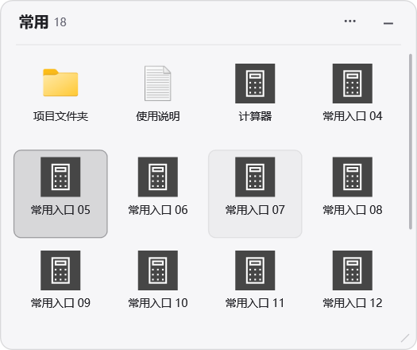
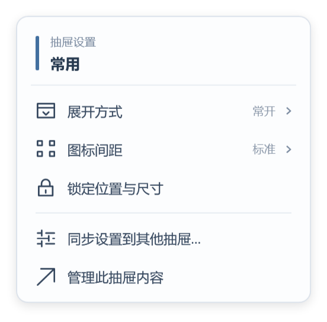
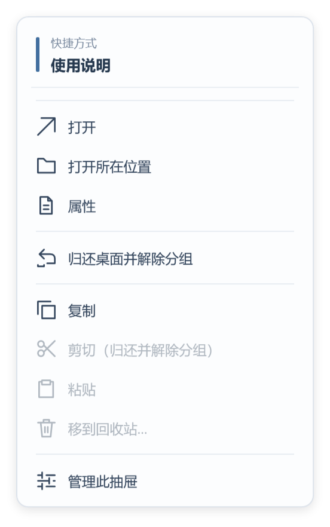

# 使用指南

本指南面向 Windows 11 x64；“背景透明度”自 1.1.0-beta.1 提供。公开包的版本差异见 [更新记录](../CHANGELOG.md)。

## 安装与首次使用

前往 [GitHub Releases](https://github.com/LaoQiTX/Qige/releases) 获取公开安装包或便携 ZIP。两者均自带 .NET 运行时。

- **安装包**。选择固定、可写的目录，完成后从开始菜单启动。
- **便携包**。完整解压到可写目录后运行 `Qige.exe`。
- **隔离样例**。运行「打开样例.cmd」，体验结束后通过托盘退出样例。

程序在 EXE 所在目录创建 `QigeData`，保存抽屉配置、托管文件及恢复记录。

## 新建抽屉与整理桌面

1. 在管理面板点「新建抽屉」，点击要创建的类型卡。
2. **桌面整理抽屉**填写名称后创建。拖入个人或公共桌面根目录的文件、文件夹或快捷方式，也可使用工作台的「添加内容」。公共桌面项目同样实际收纳，成功后桌面原图标消失，归还时回到公共桌面。权限不足或文件被占用时显示失败并保留原件，不自动改成引用。其他位置可添加为引用。
3. **文件夹映射抽屉**点击「选择目录…」，可在选择窗口里新建文件夹。确认路径后点「创建映射抽屉」。名称留空时优先使用目录名。
4. 单击图标选中，双击交给 Windows 关联程序打开。桌面整理抽屉里的托管项目可拖回桌面空白处归还并解除分组。

托管文件实际移入 `QigeData/storage`。映射抽屉显示所选目录的直接子项，子文件夹由资源管理器打开。移除映射或引用后，原件保留。

## 布局与展开方式

| 操作 | 结果 |
| --- | --- |
| 拖标题 | 移动整个抽屉 |
| 拖边缘或角 | 调整大小，图标重新排布 |
| 拖右下角灰色斜线 | 同时调整宽度和高度；锁定时禁用 |
| 滚轮或右侧滚动条 | 查看超出可见区域的内容 |
| 选择“悬停展开” | 折叠保留标题，移入展开、离开收起 |
| 选择“手动展开” | 用标题按钮或双击标题切换状态，鼠标移入移出不会自动切换 |
| 点击标题“＋ / −”或双击标题 | 悬停模式只临时开合，离开后恢复悬停；手动模式按点击开合；常开模式下切换为手动 |
| 拖文件到悬停折叠标题 | 展开并接受符合当前抽屉规则的项目 |
| 开启吸附 | 靠近屏幕或相邻抽屉的边缘、中心线时对齐 |
| 按住 Alt | 临时绕过吸附 |
| 锁定位置 | 禁止移动和调整大小，仍可打开、滚动、折叠 |

折叠抽屉靠近屏幕底部且下方空间不足时，内容会向上展开，标题留在原处；两侧都不足时按较大一侧的工作区限制高度。

位置、尺寸、手动展开状态、图标密度、背景透明度和锁定分别保存。可以在管理面板直接编辑位置和宽高；尺寸受当前显示器工作区约束。

自 1.1.1 起，分辨率切换后按新的可用工作区调整抽屉尺寸和相对位置，靠边的抽屉继续靠边；单独改变 Windows 缩放时保留逻辑尺寸并重新绘制。自动适配保留布局基准，切回原显示设置时恢复原布局，手动移动或调整尺寸后采用新的布局基准。显示器断开时临时适配可用屏幕，重新连接后回到原显示器；锁定的抽屉同样参与显示变化适配。旧配置首次运行修复版时以当时的显示设置建立基准。

拖动边框调整大小期间保持悬停抽屉展开，即使鼠标暂时离开边界也不会收起。松开后，鼠标在抽屉内则继续展开，移出后恢复自动折叠。

在属性区修改当前抽屉后，点击“同步到全部抽屉…”，勾选展开方式、锁定状态、图标密度、背景透明度中的所需项，再确认应用到其余抽屉。这是一次复制：以后更改仍只影响当前抽屉，新建抽屉也不自动继承。名称、内容、显示器、位置与尺寸不参与同步。文件操作或拖动尚未结束时，等待完成后再同步。颜色等其他外观样式尚未开放，后续选项会接入同一同步入口。

显示器断开时，抽屉尝试临时回到可见屏幕，保留原布局供接回后恢复。主动拖动或修改布局会保存新的位置。

## 抽屉设置菜单

点击标题“···”或右键标题打开当前抽屉设置。菜单顶部显示项目数。通过“展开方式”与“图标间距”子菜单调整常驻、悬停、手动模式和密度，也可切换布局锁定、同步设置或进入当前抽屉内容。

图标间距提供紧凑、标准、宽松三档。在 420 DIP 宽的抽屉中分别为 6、5、4 列；实际列数随抽屉宽度变化。此选项调整间距，不改变文件顺序。

可在标题“⋯”、标题右键的“背景透明度”子菜单，或管理面板右侧“抽屉参数”中拖动滑杆，实时预览并按抽屉保存。0% 为不透明，最高 80%，默认 12%；菜单中可恢复默认。只改变背景，图标与文字不随之变淡。

设置、内容和文件右键菜单跟随所属抽屉的透明度；菜单每深入一层，剩余透明度减半、底色略微加深。例如抽屉 60% 时，第一层菜单为 30%，第二层为 15%，第三层为 7.5%，让浮层更容易辨认。

## 抽屉右键

右键图标可复制、粘贴和打开所在位置。映射文件可剪切、重命名或移到回收站。托管项目剪切时先归还桌面并解除分组，再放入剪贴板。回收操作有垃圾桶图标并要求确认。外部引用的「移除引用」保留原件。

右键空白处可粘贴、新建网址或添加内容，具体操作随抽屉类型而变。整理抽屉粘贴个人或公共桌面的项目会收纳，其他位置的项目则添加为引用。映射抽屉将剪贴板的文件复制或移动到映射目录。打开文件夹或终端会定位到当前抽屉的实际目录。

## 管理面板

- **空间沙盘**查看全部抽屉的分布和内容预览。双击卡片进入对应抽屉的工作台。
- **工作台详情**按名称搜索抽屉或文件，用滚轮浏览内容。可用 Ctrl、Shift 或 Ctrl+A 多选。列表右上角有「排序」与「刷新」。
- **桌面整理抽屉**使用标题右侧「添加内容」收纳桌面文件和文件夹、引用外部项目或新建网址。列表上方的「整理操作」提供剪贴板、新建、重命名和批量操作。
- **文件夹映射抽屉**使用列表上方「文件操作」操作映射目录中的项目。右侧「抽屉操作」可以打开或重定位映射目录。
- **右侧属性区**修改当前抽屉的名称、展开方式、锁定、显示器、位置与尺寸。底栏「设置」或 `Ctrl+,` 打开全局设置。

| 设置页面 | 内容 |
| --- | --- |
| 通用设置 | 登录启动、吸附与对齐、抽屉文件名、备份与恢复 |
| 外观 | 云母与亚克力、亮色与暗色预览、跟随系统 |
| 运行与恢复 | 桌面连接、所有抽屉的归还与重新收纳、冲突与中断传输 |
| 关于与帮助 | 应用版本、数据目录、使用指南与隔离样例 |

在「设置 → 通用设置 → 抽屉文件名」可开启「显示快捷方式后缀」。默认隐藏 `.lnk` 和 `.url`，切换后立即应用到所有抽屉；普通文件后缀和实际文件名不变。

在「设置 → 外观」选择「云母」或「亚克力」。两套主题卡片都提供亮色和暗色预览。配色可设为亮色、暗色或跟随 Windows 应用颜色模式。主题与配色会即时保存，切换主题时会保留配色选择。各抽屉可单独调整背景透明度。亚克力更通透，云母的底色更实。两套主题的抽屉均会取桌面壁纸的颜色，Windows 关闭透明效果时切换为实色背景。

## 归还、关闭与退出

| 操作 | 文件与分组 |
| --- | --- |
| 关闭面板，保持运行 | 抽屉继续显示，可从系统托盘重新打开 |
| 归还此抽屉 / 全部归还 | 文件回桌面，保留分组记忆并暂停收纳 |
| 重新收纳 | 按保留的分组继续收纳 |
| 单项归还 / 拖回桌面 | 文件回桌面，解除该项分组 |
| 归还并移除抽屉 | 全部归还成功后移除抽屉，保留恢复历史 |
| 退出并归还全部 | 等待文件操作，归还全部内容后退出 |

归还后的桌面图标排列由 Windows 决定。同名冲突或占用会阻止归还或退出，程序保留文件并提供恢复入口，详见[问题排查](troubleshooting.md)。

## 自动备份与恢复

在“设置 → 通用设置 → 备份与恢复”中操作：

- 默认开启，每 60 分钟备份；配置变化稳定两分钟后也会触发，正在操作文件或拖动抽屉时等待下一次检查。
- 默认保存到 `QigeData/Backups`，可选数据目录外的其他磁盘。修改目录、间隔或保留数量后点击“保存备份设置”。间隔为 15–10080 分钟，保留最近 1–100 份自动备份，默认 10 份。
- 点击“立即备份”创建长期保留的手动快照。恢复前、移除抽屉前也会建立长期保留的快照，这些不参与自动轮换。
- 最近成功、失败时间与失败原因会显示在设置里。新备份完成并通过校验后才轮换自动备份；失败时保留已有备份。
- 从列表选择备份，点击“恢复所选备份…”，核对时间和抽屉数量后确认。软件先保护当前状态、归还当前内容，再恢复配置和托管内容，并重新加载抽屉。

备份包括配置、布局、分组、实际托管文件和文件夹及历史副本。外部引用和映射只保存路径。当前已归还桌面的分组入口也会保存副本，以支持原文件丢失后的恢复；不会备份快捷方式指向的程序、外部文件夹、缓存、日志或会话锁。文件正文及 Windows 下载来源等备用数据流均校验。备份不等同于整个桌面或硬盘备份。

当前格式仅支持恢复到创建备份时的同一数据目录，并使用当前用户的桌面；数据目录移动后的备份迁移暂未开放。桌面已有同名不同内容、文件缺失、格式不兼容或校验失败时会停止恢复；先另存冲突文件后重试。恢复事务中断时，下次启动会在读取配置前回滚；恢复前目录保留在 `QigeData/recovery/restore-transactions`。当前快照上限为 20000 个文件、正文合计 512 MB。

默认同盘备份适合误操作恢复，不能保护整盘损坏；需要时选择另一块磁盘。长期保留的手动和恢复前备份可在备份目录中自行整理，先保留至少一份确认可用的备份。

## 数据、更新与迁移位置

配置、收纳文件、恢复记录和可控缓存集中在软件目录的 `QigeData`，目录结构见[技术架构](architecture.md#数据目录)。

更新前选择“退出并归还全部”，备份并保留整个 `QigeData`。安装版沿用原安装目录；便携版使用完整新版程序文件，保留原数据。卸载安装版会保留数据目录。

卸载前正常“退出并归还全部”，可用托管内容回到原个人或公共桌面，分组与布局保留；同名冲突先处理。卸载器发现未归还的托管项目或待处理恢复状态时会阻止卸载。应重新运行原路径程序，处理恢复提示后退出并归还。

同一用户在原路径重装且保留完整数据，会继续读取原分组并重新收纳。只下载新版不会影响已有内容；换安装路径不会自动带入旧目录，当前也没有跨目录导入，不能直接合并两套数据。归还快捷方式不会重新安装已经卸载的目标软件。

移动软件位置前，先退出归还并关闭开机启动；移动完整软件与数据后，再在新位置开启启动项。不要将两套数据目录合并，也不要同时运行旧新版。

## 开机启动

在“设置 → 通用设置”中开启。默认关闭，按当前用户登记；登录时软件所在盘符必须可用。关闭管理面板不影响托盘运行。隔离样例会禁用此项，不修改系统启动登记。

beta.10 起优先使用当前用户的登录任务，登录时直接恢复抽屉，管理面板按需从托盘打开。原有已开启的启动项会自动迁移；任务计划程序不可用时保留原启动入口。任务不要求管理员权限，不修改 Windows 全局启动延迟。若系统仍在创建桌面，前 20 秒每约 300 毫秒重试；桌面就绪后自动连接。登录任务可在 Windows“任务计划程序库”的 `Qige-` 项中查看，关闭开机启动会移除此任务。

后续界面优化见 [开发计划](roadmap.md)。

## 已卸载入口的失效记录

外部卸载或删除导致桌面与收纳文件均不存在时，记录会保留供检查，但不阻止退出。在工作台内容列表直接点击“移除失效记录”，或在“设置 → 运行与恢复”选择同名操作并确认后，该项从抽屉和待处理列表移除；历史元数据与已有副本保留。操作会重新确认文件确实缺失，拒绝清理重新出现的文件、尚有待处理副本或目录不可访问的项目。

## 从沙盘编辑抽屉内容

单击沙盘卡片选择抽屉；双击该卡片（包括标题或图标预览区域）进入工作台并展示该抽屉全部内容，清除旧搜索筛选。可以针对该抽屉打开、归还内容或移除失效记录。已确认不存在的文件不再出现在沙盘图标预览中，卡片会标出失效数量；进入工作台后仍保留条目供确认清理。空白区域双击不会跳转。
